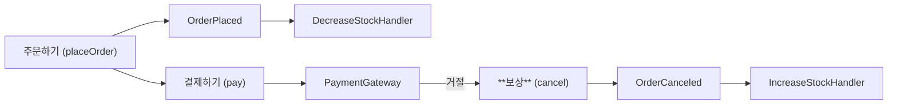

# order-saga 흐름

주문하기는 주문을 저장하고 주문 접수됨 OrderPlaced를 발행기에 넘기고, 재고 줄이기 처리기 DecreaseStockHandler가 나중에 재고를 줄인다. 결제하기는 결제 금액을 결제 창구 PaymentGateway에 맡긴다. 거절되면 보상으로 주문 취소하기 cancel을 부른다. 취소하기는 주문을 취소로 저장하고 주문 취소됨 OrderCanceled를 넘기며, 재고 되돌리기 처리기 IncreaseStockHandler가 나중에 재고를 되돌린다. 승인되면 지금처럼 저장하고 결제 완료 메시지를 넘긴다.
