# payment-acl 흐름

```mermaid
flowchart LR
  subgraph order ["주문 컨텍스트"]
    A["결제하기 (pay)"] --> B[PaymentGateway]
    B --> C[LegacyPaymentAdapter]
    C -- "**PaymentResult**" --> A
    A --> D{승인인가}
    D -- 예 --> E[저장과 결제 완료 메시지]
    D -- 아니오 --> F[거절 이유로 거절]
  end
  C -- "DDD-SHOP, 결제 금액" --> G[LegacyPayGateway]
  G -- "0000, E101" --> C
```

주문 서비스 OrderService의 결제하기는 결제 금액을 우리 말로 정한 결제 창구 PaymentGateway에 맡긴다. 결제 창구를 구현한 결제 어댑터 LegacyPaymentAdapter가 부패 방지 계층이다. 어댑터는 결제 금액에 가게 키를 붙여 외부 결제 모듈 LegacyPayGateway에 맡긴다. 받은 코드 글자 0000은 승인, E101은 거절 이유 결제 한도를 넘었습니다, 그 밖은 결제에 실패했습니다로 번역해 결제 결과 PaymentResult로 돌려준다. 승인이면 주문을 저장하고 결제 완료 알리미로 결제 완료 메시지를 넘기고, 거절이면 저장하지 않아 주문은 주문 접수로 남는다. 외부 모듈을 import하는 곳은 어댑터와 둘을 잇는 Main뿐이다.
