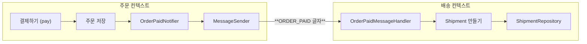

# shipping-context 흐름

주문 컨텍스트의 공개 호스트 서비스인 결제 완료 알리미가 결제 완료를 ORDER_PAID|orderId=1|address=서울시 강남구 같은 한 줄 글자로 만들어 메시지 보내기에 넘긴다. 이 글자 모양이 발행된 언어다. Main이 메시지 보내기를 람다로 만들어 보낸 메시지를 찍고 배송 컨텍스트의 결제 완료 메시지 처리기에 건넨다. 처리기는 글자만 읽어 주문 번호와 배송 주소로 배송을 만들어 저장한다. 배송 컨텍스트는 주문 컨텍스트의 클래스를 import하지 않는다. 두 컨텍스트를 잇는 곳은 지금처럼 Main 한 곳이다.
