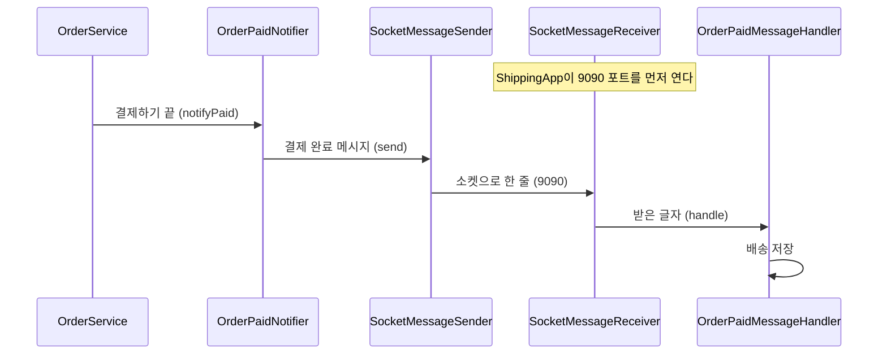

# socket-queue 흐름

배송 앱 ShippingApp이 소켓 받는 곳 SocketMessageReceiver로 9090번 포트를 먼저 열고 기다린다. 주문 앱 OrderApp은 메시지 보내기 자리에 소켓 메시지 보내기 SocketMessageSender를 넣어 주문 서비스 OrderService를 만든다. 결제하기가 끝나면 결제 완료 알리미 OrderPaidNotifier가 결제 완료 메시지 글자를 메시지 보내기에 넘기고, 소켓 메시지 보내기는 그 글자를 9090번 포트로 한 줄 보낸다. 배송 앱은 받은 글자를 결제 완료 메시지 처리기 OrderPaidMessageHandler에 넘겨 배송을 만들어 저장한다. 주문 접수됨 같은 도메인 이벤트는 소켓으로 보내지 않고 이벤트 발행기에 남는다. 주문 서비스, 결제 완료 알리미, 처리기는 앞 장 그대로다.
