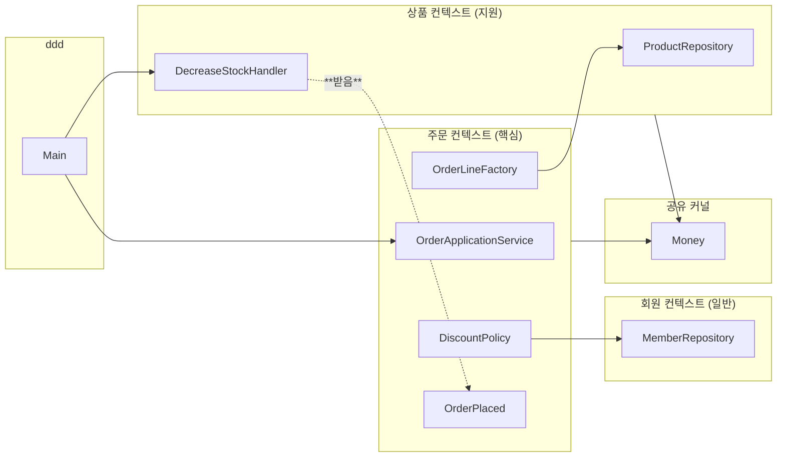

# bounded-contexts 흐름

화살표는 가져다 쓰는 방향이다. 주문 컨텍스트의 주문 항목 팩토리는 상품 저장소를, 할인 정책은 회원을 읽는다. 상품 컨텍스트의 재고 줄이기 처리기는 주문 접수됨 이벤트를 받는다. 주문과 상품은 공유 커널의 돈을 함께 쓰고, 회원은 돈을 쓰지 않는다. 컨텍스트마다 안은 layers 장의 계층 그대로이고, 컨텍스트를 잇는 곳은 지금처럼 Main 한 곳이다.
