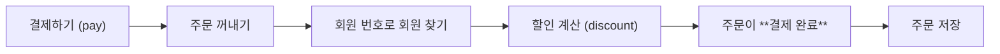
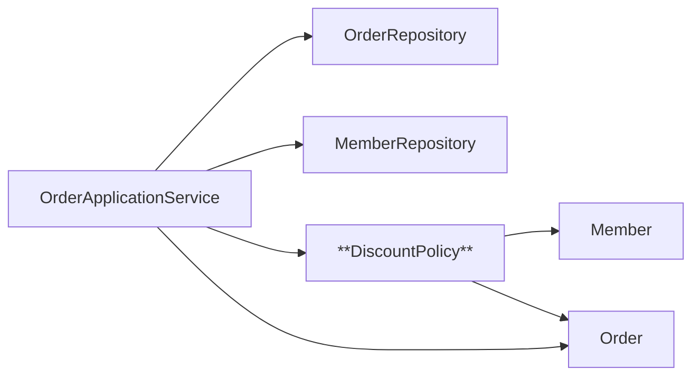

# discount 흐름

위 그림은 결제하기의 흐름이다. 응용 서비스가 주문을 꺼내고 주문의 회원 번호로 회원을 찾는다. 할인 정책이 회원 등급과 주문 금액으로 할인 금액을 계산해 돌려준다. VIP는 주문 금액의 10%, 일반은 0원이다. 주문은 그 할인 금액을 받아 기억하며 결제 완료가 되고, 응용 서비스가 저장한다. 아래 그림은 누가 누구를 쓰는지다. 할인 정책은 도메인 계층의 도메인 서비스로 회원과 주문을 읽기만 하고 저장소를 쓰지 않는다. 저장소를 꺼내고 저장하는 일은 응용 서비스만 한다.
