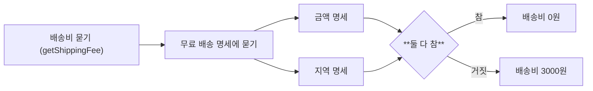
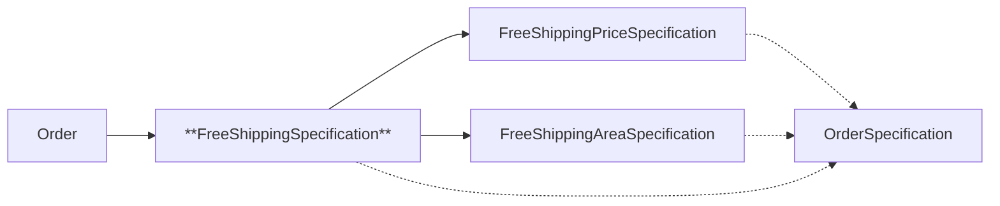

# free-shipping 흐름

위 그림은 배송비를 묻는 흐름이다. 주문은 배송비를 내줄 때 무료 배송 명세에게 이 주문이 무료 배송인지 묻는다. 무료 배송 명세는 금액 명세(결제 금액 50000원 이상)와 지역 명세(제주가 아닌 주소)를 and로 묶은 것이라 둘 다 참일 때만 참이다. 명세는 참 거짓만 답하고, 0원과 3000원은 주문이 정한다. 아래 그림은 누가 누구를 쓰는지다. 실선은 쓰는 것이고 점선은 주문 명세의 모양을 따르는 것이다. 세 명세가 모두 주문 명세라서 and로 묶을 수 있고, 묶은 것도 다시 주문 명세가 된다. 응용 서비스는 바뀌지 않았다.
