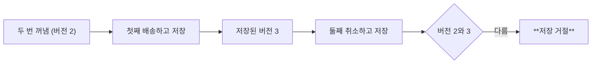
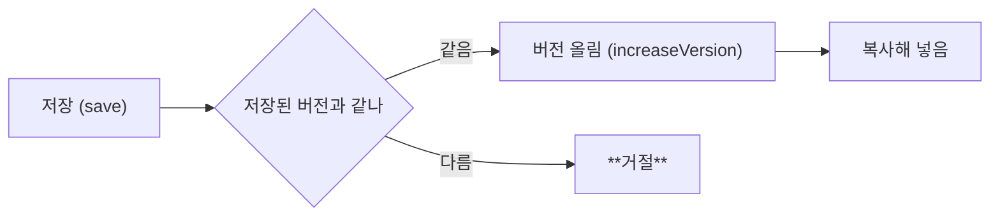

# optimistic-lock 흐름

위 그림은 Main의 동시 수정 장면이다. 결제 완료인 주문은 주문하기와 결제하기로 두 번 저장돼 버전 2다. 이 주문을 두 번 꺼내면 첫째와 둘째 모두 버전 2를 들고 있다. 첫째로 배송하고 저장하면 저장된 주문은 버전 3이 된다. 둘째는 옛 상태인 결제 완료를 보고 취소했지만 들고 있는 버전은 아직 2다. 저장소가 2와 3을 비교해 다르니 둘째의 저장을 거절해서 배송 중인 주문이 지켜진다. 아래 그림은 주문 저장소의 저장하기 안쪽이다. 같은 번호로 저장된 주문이 있으면 버전을 먼저 비교한다. 같을 때만 버전을 1 올리고 복사 생성자로 복사해 넣는다. 꺼낼 때 잠그지 않고 저장할 때만 확인하는 것이 낙관적 잠금이다.
