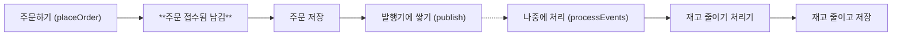
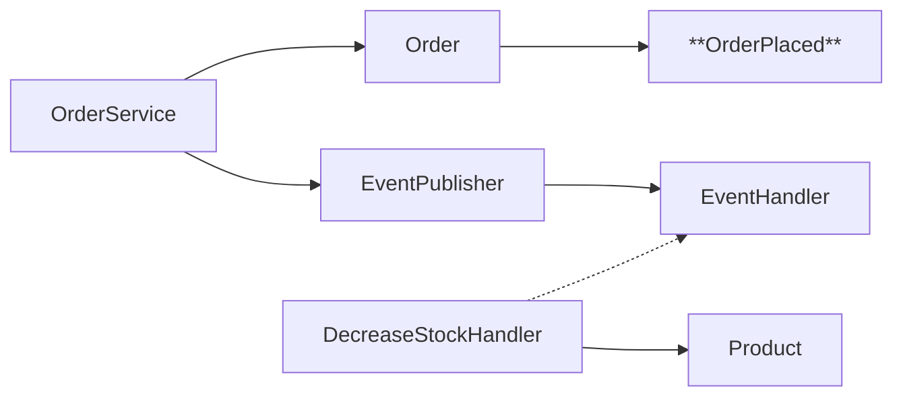

# order-events 흐름

위 그림은 주문 하나가 재고까지 닿는 흐름이다. 주문 응용 서비스가 주문을 만들면 주문은 주문 접수됨 이벤트를 남긴다. 주문 응용 서비스는 주문을 저장하고, 주문이 남긴 이벤트를 발행기에 넘긴 뒤 끝난다. 여기까지가 한 번의 일이라 재고는 아직 그대로다. 점선 뒤는 다른 일이다. 발행기가 쌓인 이벤트를 처리하면 구독한 처리기마다 이벤트를 받는다. 재고 줄이기 처리기는 주문 접수됨만 골라 주문 항목마다 상품 재고를 줄이고 저장해서 재고가 나중에 맞춰진다. 아래 그림은 누가 누구를 쓰는지다. 주문은 상품을 모르고 이벤트만 남긴다. 발행기는 이벤트 처리기 인터페이스만 알고, 재고 줄이기 처리기가 그 인터페이스를 구현해 상품을 바꾼다.
