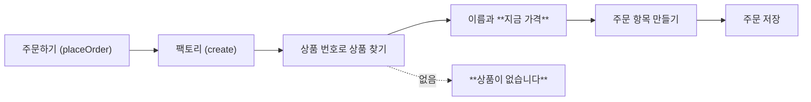
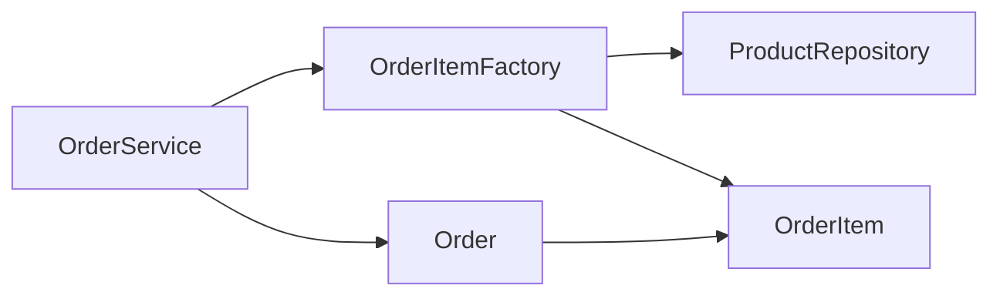

# order-factory 흐름

위 그림은 주문하기와 주문 항목 더하기의 흐름이다. 요청에는 상품 번호와 수량만 있고, 팩토리가 상품 저장소에서 상품을 찾아 이름과 지금 가격으로 주문 항목을 만든다. 상품이 없으면 팩토리가 거절하고 아무것도 저장하지 않는다. 아래 그림은 누가 누구를 쓰는지다. 팩토리는 도메인 계층에 있고 저장소 약속 ProductRepository만 쓴다. 주문과 주문 항목은 저장소를 모른다.
