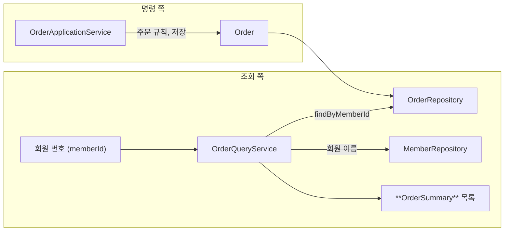

# order-query 흐름

명령 쪽의 주문 응용 서비스는 주문 애그리거트 Order에 일을 시켜 규칙을 지키며 상태를 바꾸고 주문 저장소에 저장한다. 조회 쪽의 주문 조회 서비스 OrderQueryService는 회원 번호를 받아 주문 저장소의 findByMemberId로 그 회원의 주문을 꺼내고, 회원 저장소에서 회원 이름을 찾아 주문 요약 OrderSummary로 옮겨 담는다. 주문 요약은 주문 번호, 회원 이름, 항목 수, 결제 금액, 상태 글자를 숫자와 글자로만 가진 record다. 조회 쪽은 주문을 바꾸거나 저장하지 않고, 결제 창구와 발행기를 모른다.
