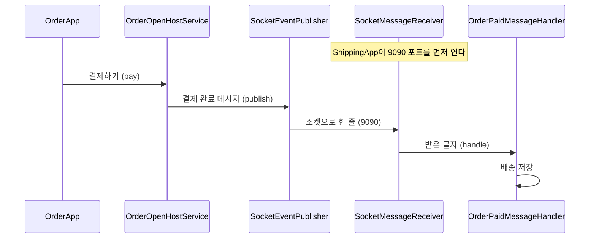

# socket-queue 흐름

배송 앱 ShippingApp이 소켓 받는 곳 SocketMessageReceiver로 9090번 포트를 먼저 열고 기다린다. 주문 앱 OrderApp은 이벤트 발행기 자리에 소켓 발행기 SocketEventPublisher를 넣어 주문 응용 서비스를 만든다. 결제하기가 끝나면 공개 호스트 서비스 OrderOpenHostService가 결제 완료 메시지 글자를 발행기에 넘기고, 소켓 발행기는 그 글자를 9090번 포트로 한 줄 보낸다. 배송 앱은 받은 글자를 결제 완료 메시지 처리기 OrderPaidMessageHandler에 넘겨 배송을 만들어 저장한다. 주문 접수됨 같은 다른 이벤트는 소켓으로 보내지 않고 발행기 안에 남는다. 주문 응용 서비스, 공개 호스트 서비스, 처리기는 앞 장 그대로다.
