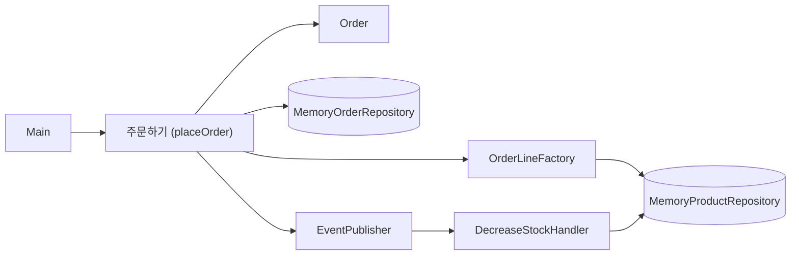
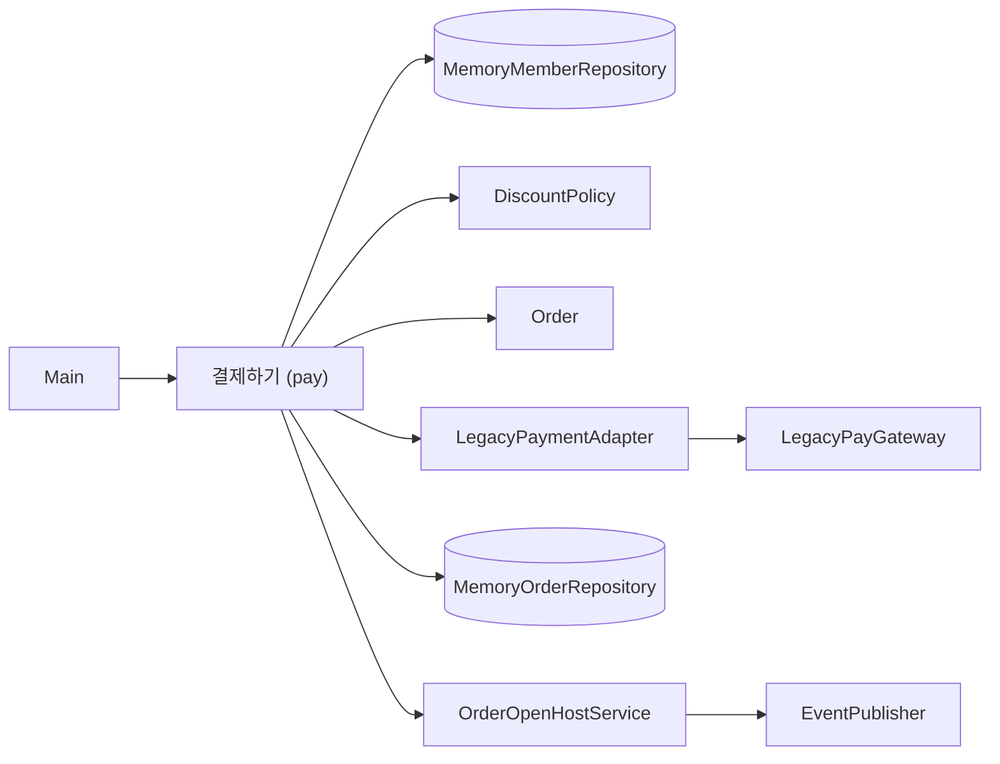
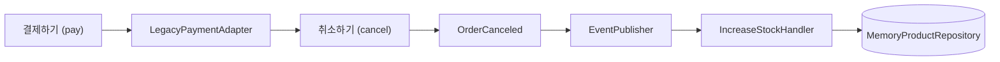
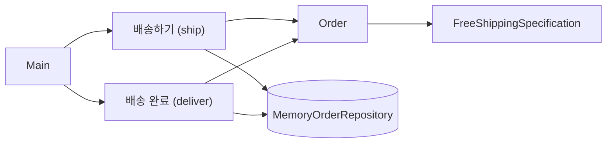
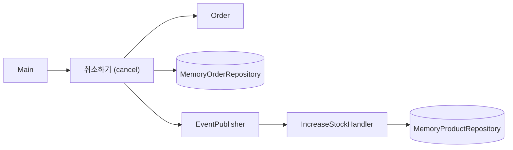
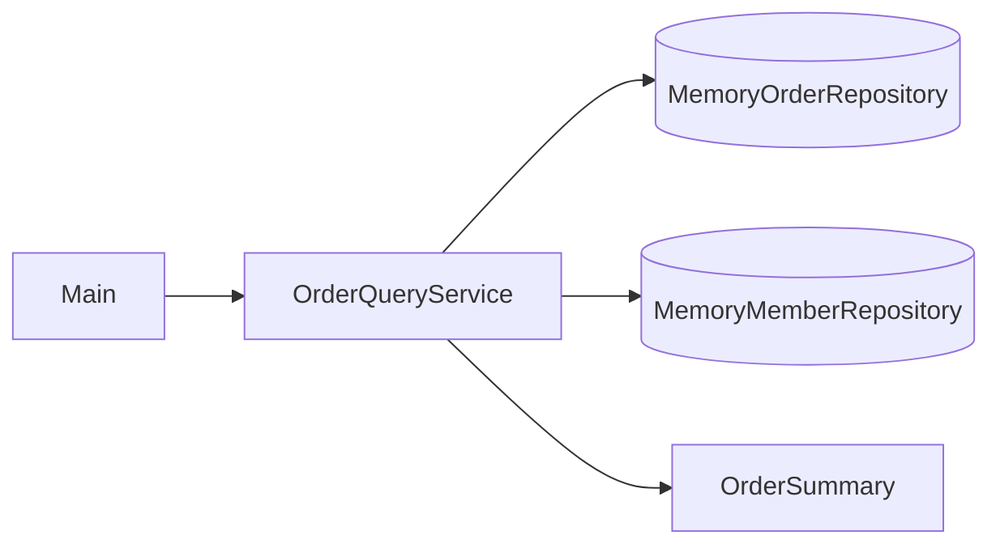
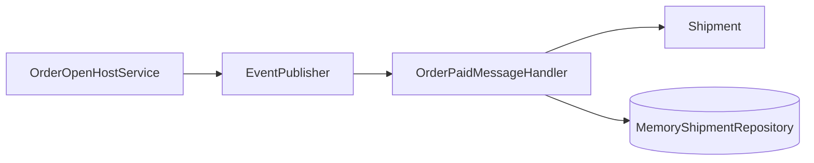
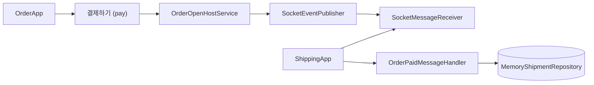

# 시나리오별 구조도

화면이 없는 콘솔 프로그램이다.
Main이 장면을 차례로 실행한다.
저장소는 모두 HashMap이다.

## 주문하기

만든 장: anemic-order, rich-entity, value-object, order-aggregate, order-repository, place-order, layers, id-reference, order-factory, order-events, bounded-contexts
맡는 파일
- ddd/src/ddd/order/application/OrderApplicationService.java
- ddd/src/ddd/order/application/PlaceOrderCommand.java
- ddd/src/ddd/order/application/OrderLineCommand.java
- ddd/src/ddd/order/domain/Order.java
- ddd/src/ddd/order/domain/OrderLine.java
- ddd/src/ddd/order/domain/OrderLineFactory.java
- ddd/src/ddd/order/domain/Address.java
- ddd/src/ddd/order/domain/OrderPlaced.java
- ddd/src/ddd/order/infrastructure/MemoryOrderRepository.java
- ddd/src/ddd/order/application/EventPublisher.java
- ddd/src/ddd/catalog/application/DecreaseStockHandler.java
- ddd/src/ddd/catalog/domain/Product.java
- ddd/src/ddd/shared/Money.java

## 결제하기

만든 장: anemic-order, order-status, discount, shipping-context, payment-acl
맡는 파일
- ddd/src/ddd/order/application/OrderApplicationService.java
- ddd/src/ddd/order/domain/DiscountPolicy.java
- ddd/src/ddd/order/domain/PaymentGateway.java
- ddd/src/ddd/order/domain/PaymentResult.java
- ddd/src/ddd/order/infrastructure/LegacyPaymentAdapter.java
- ddd/src/legacypay/LegacyPayGateway.java
- ddd/src/ddd/order/application/OrderOpenHostService.java
- ddd/src/ddd/member/domain/Member.java
- ddd/src/ddd/member/domain/MemberGrade.java

## 결제 실패 되돌리기

만든 장: payment-acl, order-saga
맡는 파일
- ddd/src/ddd/order/application/OrderApplicationService.java
- ddd/src/ddd/order/domain/OrderCanceled.java
- ddd/src/ddd/catalog/application/IncreaseStockHandler.java
- ddd/where-rules-live.md

## 배송

만든 장: anemic-order, rich-entity, order-status, free-shipping, optimistic-lock
맡는 파일
- ddd/src/ddd/order/application/OrderApplicationService.java
- ddd/src/ddd/order/domain/Order.java
- ddd/src/ddd/order/domain/OrderStatus.java
- ddd/src/ddd/order/domain/OrderSpecification.java
- ddd/src/ddd/order/domain/FreeShippingSpecification.java
- ddd/src/ddd/order/domain/FreeShippingPriceSpecification.java
- ddd/src/ddd/order/domain/FreeShippingAreaSpecification.java
- ddd/src/ddd/order/infrastructure/MemoryOrderRepository.java

## 취소

만든 장: anemic-order, order-status, optimistic-lock, order-saga
맡는 파일
- ddd/src/ddd/order/application/OrderApplicationService.java
- ddd/src/ddd/order/domain/Order.java
- ddd/src/ddd/order/domain/OrderCanceled.java
- ddd/src/ddd/order/infrastructure/MemoryOrderRepository.java
- ddd/src/ddd/catalog/application/IncreaseStockHandler.java

## 주문 목록 보기

만든 장: order-query
맡는 파일
- ddd/src/ddd/order/application/OrderQueryService.java
- ddd/src/ddd/order/application/OrderSummary.java
- ddd/src/ddd/order/domain/OrderRepository.java

## 배송 컨텍스트에 결제 알리기

만든 장: shipping-context
맡는 파일
- ddd/src/ddd/order/application/OrderOpenHostService.java
- ddd/src/ddd/shipping/application/OrderPaidMessageHandler.java
- ddd/src/ddd/shipping/domain/Shipment.java
- ddd/src/ddd/shipping/infrastructure/MemoryShipmentRepository.java
- ddd/context-map.md

## 소켓으로 배송 알리기

만든 장: shipping-context, socket-queue
맡는 파일
- ddd/src/ddd/OrderApp.java
- ddd/src/ddd/ShippingApp.java
- ddd/src/ddd/order/application/SocketEventPublisher.java
- ddd/src/ddd/shipping/infrastructure/SocketMessageReceiver.java
- ddd/src/ddd/shipping/application/OrderPaidMessageHandler.java
