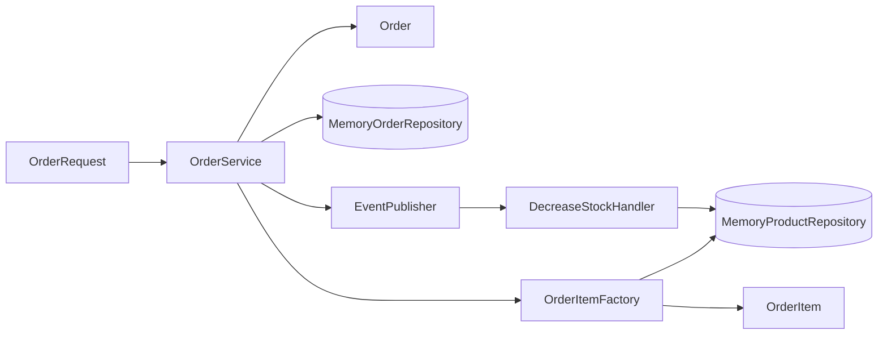
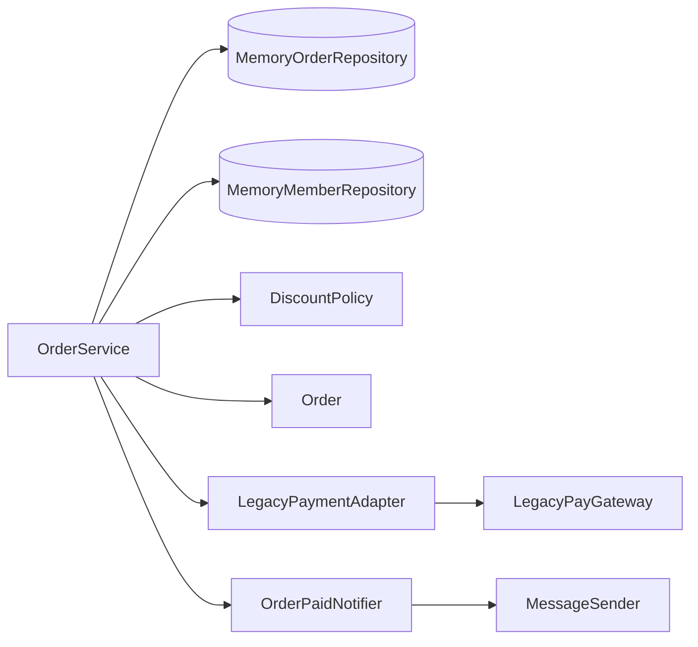
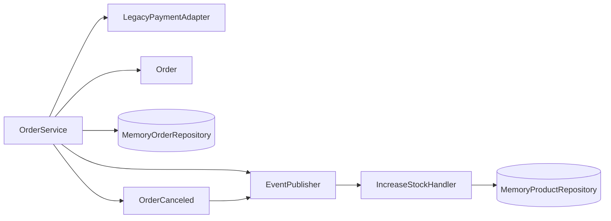
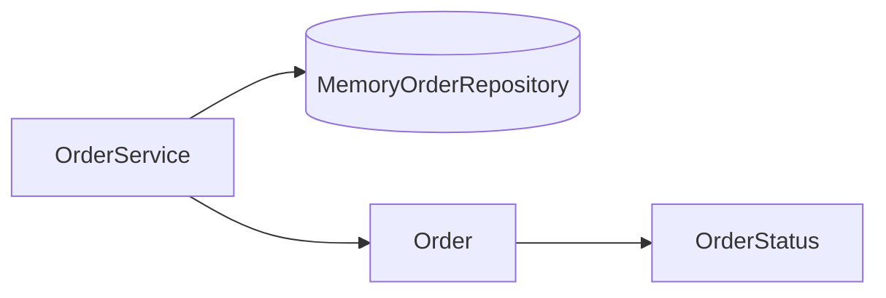
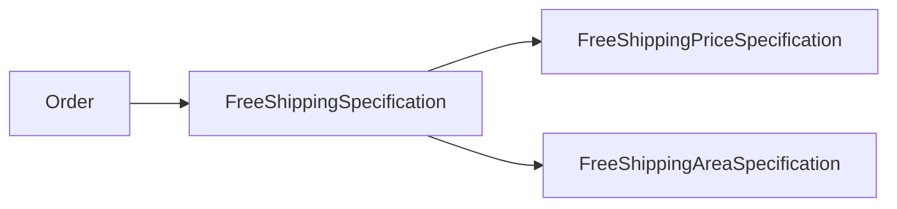
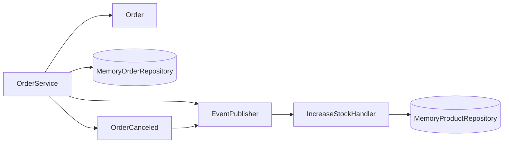
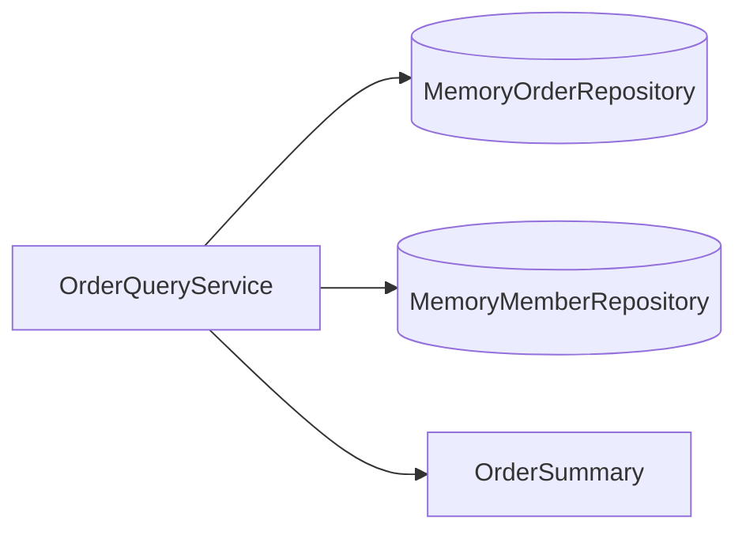
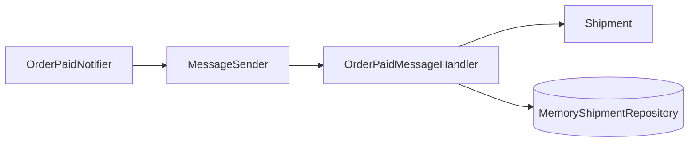
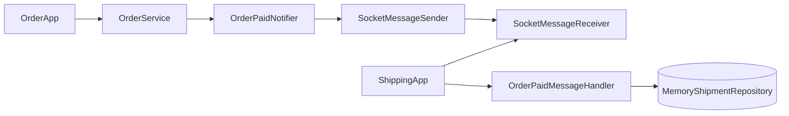

# 시나리오별 구조도

화면이 없는 콘솔 프로그램이다.
현재 코드의 클래스와 호출 관계로 흐름을 그린다.
각 흐름의 실행 장면은 해당 장의 따라치기와 캡처에 있다.
현재 Main은 결제 실패 되돌리기 장면만 실행하고 소켓 장면은 OrderApp과 ShippingApp으로 실행한다.
이벤트 처리는 발행기에 쌓은 뒤 processEvents를 부를 때 진행된다.

## 주문하기

만든 장: anemic-order, rich-entity, value-object, order-aggregate, order-repository, place-order, layers, id-reference, order-factory, order-events, bounded-contexts
맡는 파일
- ddd/src/ddd/order/application/OrderRequest.java
- ddd/src/ddd/order/application/OrderItemRequest.java
- ddd/src/ddd/order/application/OrderService.java
- ddd/src/ddd/order/domain/OrderItemFactory.java
- ddd/src/ddd/order/domain/OrderItem.java
- ddd/src/ddd/order/domain/Order.java
- ddd/src/ddd/order/domain/Address.java
- ddd/src/ddd/order/domain/OrderPlaced.java
- ddd/src/ddd/order/infrastructure/MemoryOrderRepository.java
- ddd/src/ddd/order/application/EventHandler.java
- ddd/src/ddd/order/application/EventPublisher.java
- ddd/src/ddd/catalog/application/DecreaseStockHandler.java

## 결제하기

만든 장: anemic-order, order-status, discount, shipping-context, payment-acl
맡는 파일
- ddd/src/ddd/order/application/OrderService.java
- ddd/src/ddd/order/domain/DiscountPolicy.java
- ddd/src/ddd/order/domain/PaymentGateway.java
- ddd/src/ddd/order/domain/PaymentResult.java
- ddd/src/ddd/order/infrastructure/LegacyPaymentAdapter.java
- ddd/src/legacypay/LegacyPayGateway.java
- ddd/src/ddd/order/application/OrderPaidNotifier.java
- ddd/src/ddd/order/application/MessageSender.java

## 결제 실패 되돌리기

만든 장: payment-acl, order-saga
맡는 파일
- ddd/src/ddd/order/application/OrderService.java
- ddd/src/ddd/order/domain/OrderCanceled.java
- ddd/src/ddd/catalog/application/IncreaseStockHandler.java
- ddd/where-rules-live.md

## 배송 상태 바꾸기

만든 장: anemic-order, rich-entity, order-status, optimistic-lock
맡는 파일
- ddd/src/ddd/order/application/OrderService.java
- ddd/src/ddd/order/domain/Order.java
- ddd/src/ddd/order/domain/OrderStatus.java
- ddd/src/ddd/order/infrastructure/MemoryOrderRepository.java

## 배송비 확인하기

만든 장: free-shipping
맡는 파일
- ddd/src/ddd/order/domain/Order.java
- ddd/src/ddd/order/domain/OrderSpecification.java
- ddd/src/ddd/order/domain/FreeShippingSpecification.java
- ddd/src/ddd/order/domain/FreeShippingPriceSpecification.java
- ddd/src/ddd/order/domain/FreeShippingAreaSpecification.java

## 주문 취소하기

만든 장: anemic-order, order-status, optimistic-lock, order-saga
맡는 파일
- ddd/src/ddd/order/application/OrderService.java
- ddd/src/ddd/order/domain/Order.java
- ddd/src/ddd/order/domain/OrderCanceled.java
- ddd/src/ddd/order/infrastructure/MemoryOrderRepository.java
- ddd/src/ddd/catalog/application/IncreaseStockHandler.java

## 주문 목록 보기

만든 장: order-query
맡는 파일
- ddd/src/ddd/order/application/OrderQueryService.java
- ddd/src/ddd/order/application/OrderSummary.java
- ddd/src/ddd/order/domain/OrderRepository.java

## 배송 컨텍스트에 결제 알리기

만든 장: shipping-context
맡는 파일
- ddd/src/ddd/order/application/OrderPaidNotifier.java
- ddd/src/ddd/order/application/MessageSender.java
- ddd/src/ddd/shipping/application/OrderPaidMessageHandler.java
- ddd/src/ddd/shipping/domain/Shipment.java
- ddd/src/ddd/shipping/infrastructure/MemoryShipmentRepository.java
- ddd/context-map.md

## 소켓으로 배송 알리기

만든 장: shipping-context, socket-queue
맡는 파일
- ddd/src/ddd/OrderApp.java
- ddd/src/ddd/ShippingApp.java
- ddd/src/ddd/order/application/MessageSender.java
- ddd/src/ddd/order/infrastructure/SocketMessageSender.java
- ddd/src/ddd/shipping/infrastructure/SocketMessageReceiver.java
- ddd/src/ddd/shipping/application/OrderPaidMessageHandler.java
