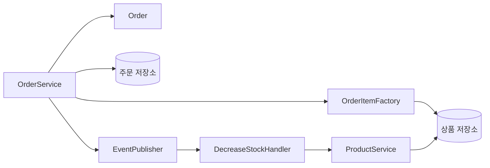
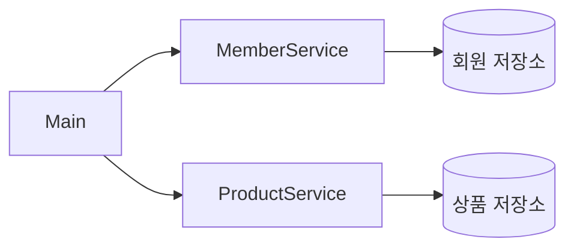
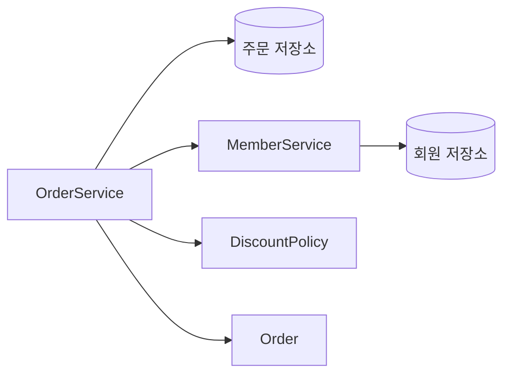
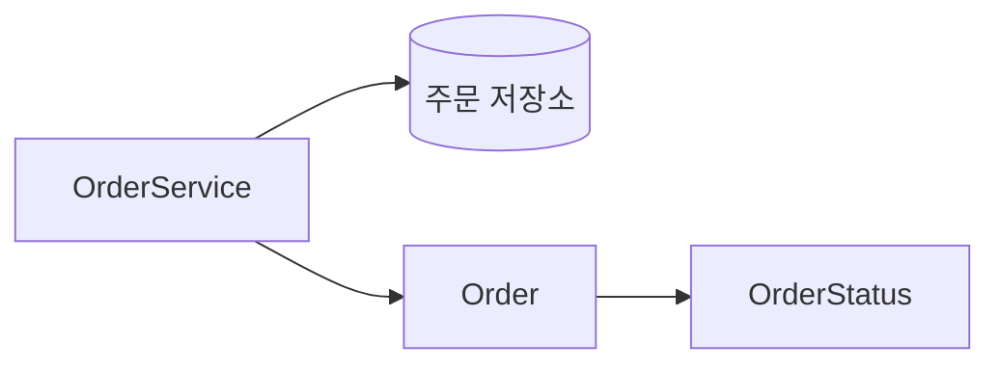
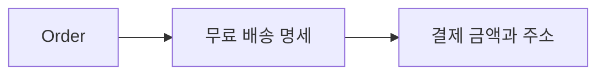

# 시나리오별 구조도

화면이 없는 콘솔 프로그램이다.
현재 Main은 회원 목록, 상품 목록, 주문 접수와 재고 감소를 실행한다.
주문 이벤트는 발행 즉시 같은 스레드에서 처리한다.

## 주문하기

만든 장: anemic-order, order-aggregate, order-repository, place-order, layers, id-reference, order-factory, order-events, bounded-contexts
맡는 파일
- ddd/src/ddd/order/application/OrderService.java
- ddd/src/ddd/order/domain/OrderItemFactory.java
- ddd/src/ddd/order/domain/Order.java
- ddd/src/ddd/order/domain/OrderPlaced.java
- ddd/src/ddd/order/application/EventPublisher.java
- ddd/src/ddd/catalog/application/DecreaseStockHandler.java
- ddd/src/ddd/catalog/application/ProductService.java

## 회원과 상품 목록 보기

만든 장: bounded-contexts
맡는 파일
- ddd/src/ddd/member/application/MemberService.java
- ddd/src/ddd/member/domain/MemberRepository.java
- ddd/src/ddd/member/infrastructure/MemoryMemberRepository.java
- ddd/src/ddd/catalog/application/ProductService.java
- ddd/src/ddd/catalog/domain/ProductRepository.java
- ddd/src/ddd/catalog/infrastructure/MemoryProductRepository.java

## 결제 상태 바꾸기

만든 장: anemic-order, order-status, discount, bounded-contexts
맡는 파일
- ddd/src/ddd/order/application/OrderService.java
- ddd/src/ddd/member/application/MemberService.java
- ddd/src/ddd/order/domain/DiscountPolicy.java
- ddd/src/ddd/order/domain/Order.java

외부 결제 모듈을 호출하지 않고 주문의 할인 금액과 결제 상태를 바꾼다.

## 배송 상태와 취소 상태 바꾸기

만든 장: anemic-order, rich-entity, order-status, optimistic-lock
맡는 파일
- ddd/src/ddd/order/application/OrderService.java
- ddd/src/ddd/order/domain/Order.java
- ddd/src/ddd/order/domain/OrderStatus.java
- ddd/src/ddd/order/infrastructure/MemoryOrderRepository.java

이번 강의는 취소 시 재고를 복원하지 않는다.

## 배송비 확인하기

만든 장: free-shipping
맡는 파일
- ddd/src/ddd/order/domain/Order.java
- ddd/src/ddd/order/domain/FreeShippingSpecification.java

결제 금액이 50000원 이상이고 제주 주소가 아니면 무료 배송이다.
